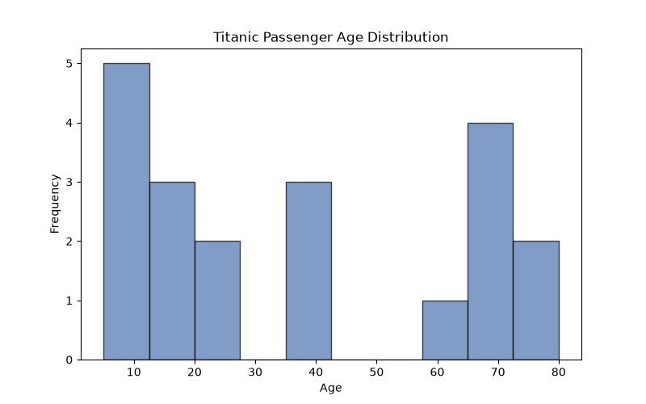

# Day 6 实验日志：数据分布分析与环境隔离

## 1. 今日目标
- 掌握 Pandas 的 `dropna` 清理特定列缺失值。
- 掌握 Matplotlib 绘制直方图（Histogram）。
- 生成规范的 `requirements.txt` 环境锁文件。

## 2. 操作过程
- 编写 `day6_distribution.py`。
- 读取数据后，剔除了 `Age` 列为空的行。
- 使用 `plt.hist()` 绘制了年龄分布图。
- 提取了本次运行的核心依赖包，写入 `requirements.txt`。

## 3. 核心结果
- **成功截图**：
- 数据说明：本图表基于 20 行脱敏测试样本生成，用于验证代码流程。

## 4. 踩坑与失败记录
- 报错：如果 `Age` 列有缺失值，`plt.hist()` 会报错无法绘制。
- 解决：提前使用 `df.dropna(subset=['Age'])` 剔除缺失行，成功绘图。