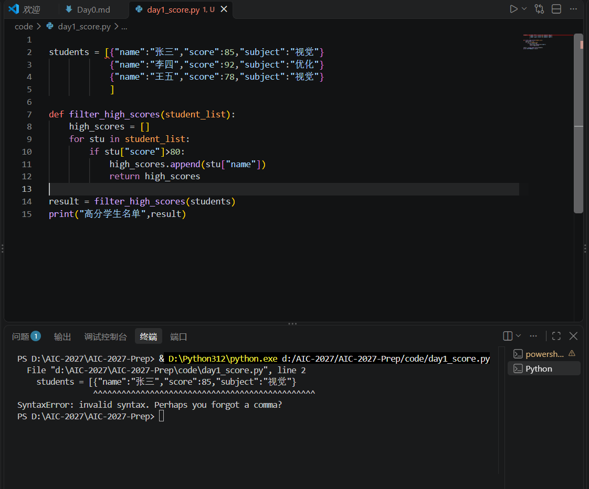

# Day 1 实验日志

## 1. 今日目标
- 掌握 Python 列表、字典、for 循环和 if 判断的基本用法。
- 熟悉 VS Code 的运行流程，并完成故意制造报错的破坏测试。

## 2. 操作过程
- 在 `code/day1_score.py` 中手打代码，实现从嵌套字典列表中筛选出成绩 > 80 分的学生名单。
- 故意删除了 `if` 语句下方代码的缩进，测试 Python 的报错机制。

## 3. 核心结果
- 终端成功输出：`高分学生名单: ['张三', '李四']`
- 证明代码逻辑正确，能够成功遍历并筛选数据。

## 4. 踩坑与失败记录
- **报错现场截图**： 
- **报错信息**：`IndentationError: expected an indented block after 'if' statement on line 10`
- **报错原因**：Python 不使用大括号 `{}` 来划分代码块，而是依靠严格的缩进。我删掉了第 11 行的缩进，导致 `if` 语句下面没有属于它的执行代码，Python 不知道条件成立时该干嘛，所以报错。
- **解决处方**：在 `if` 下一行按 Tab 键（或4个空格）进行缩进，重新运行成功。