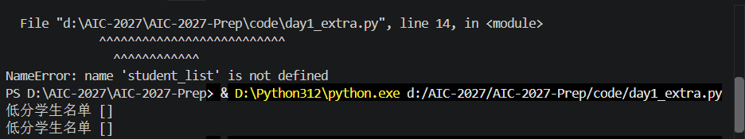

# Day 1 额外补充日志：闭卷拓展练习与深度排错

## 1. 练习目标
- 脱离教程，凭记忆独立修改代码逻辑。
- 将原本的“筛选 > 80 分”修改为“筛选 < 80 分”，并修改函数名使其语义一致。

## 2. 操作过程
- 新建文件 `day1_extra.py`。
- 手动输入列表和字典数据，将判断条件修改为 `< 80`，并将函数名改为 `filter_low_scores`。

## 3. 核心结果（证据）
- 终端最终成功输出：`低分学生名单: ['王五']`
- 证明我已完全掌握 `for` 循环、`if` 条件分支以及 `return` 返回值的底层逻辑。

## 4. 踩坑与失败记录（极其宝贵的实战排错复盘）

### ❌ 报错 1：变量名前后不一致导致 `NameError`
- **报错现场截图**：
- **报错信息**：`NameError: name 'student_list' is not defined`
- **报错原因**：在定义函数时，参数名写的是 `student`。但在函数内部的 `for` 循环中，我写成了 `student_list`，导致电脑找不到这个变量。
- **解决处方**：将循环里的变量统一改为 `student`，保持前后一致。

### ❌ 报错 2：缩进错误导致逻辑提前结束（输出为空列表）
- **报错现场截图**：
- **报错现象**：终端没有报错，但输出结果为空列表 `低分学生名单: []`。
- **报错原因**：`return low_scores` 的缩进层级错误，与 `low_scores.append(...)` 对齐了。这导致电脑在检查第一个学生（张三）不满足条件后，直接执行了 `return` 退出了函数，根本没检查后面的王五。
- **解决处方**：将 `return low_scores` 退回一格（Backspace），与 `for` 循环对齐，确保循环遍历完所有学生后再返回最终结果。

## 5. 闭卷拓展思考
- 经过这次盲敲，我彻底明白了 Python 对于缩进的严格要求。缩进不仅仅是排版，更是代码逻辑（层级关系）的直接体现。未来的代码编写中，我会时刻关注缩进层级，避免逻辑错误。