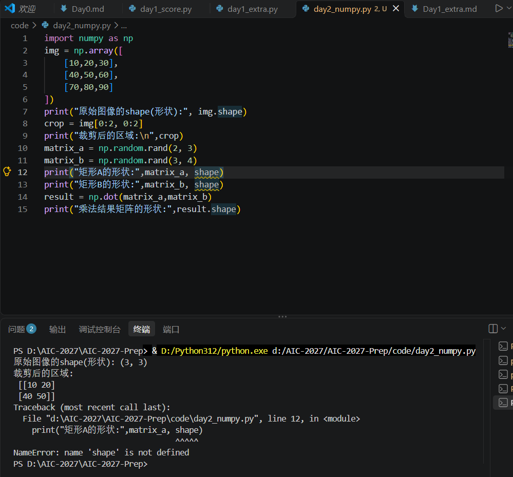
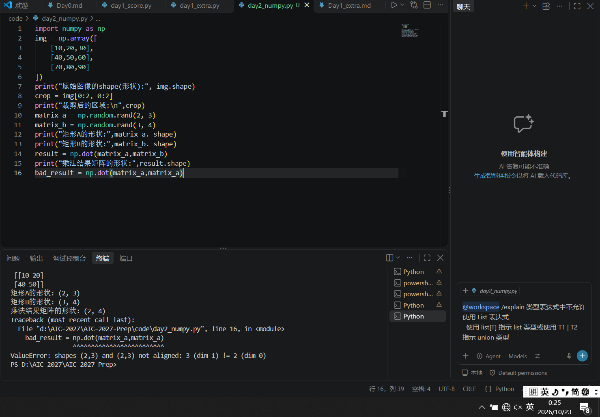

# Day 2 实验日志：NumPy 基础与矩阵维度直觉

## 1. 今日目标
- 掌握 NumPy 数组的创建、切片操作。
- 理解矩阵乘法（np.dot）的规则。
- 亲自触发并理解 AI 领域最常见的“维度不匹配”报错。

## 2. 操作过程
- 编写 `code/day2_numpy.py`。
- 用 `np.array` 模拟了 3x3 图像矩阵并成功进行切片。
- 使用 `np.random.rand` 创建了 (2,3) 和 (3,4) 两个矩阵，成功进行矩阵乘法，结果 shape 为 (2,4)。

## 3. 核心结果
- 成功输出切片区域和乘法结果的 shape。
- 证明了矩阵乘法规则：左矩阵的列数必须等于右矩阵的行数。

## 4. 踩坑与失败记录

### ❌ 报错 1：把属性当成了变量（NameError）
- **报错现场截图**：
- **报错信息**：`NameError: name 'shape' is not defined`
- **报错原因**：我一开始在打印矩阵形状时，写成了 `print(matrix_a, shape)`。在 Python 中，`shape` 是矩阵的专属属性，必须通过点 `.` 来调用，不能作为独立变量存在。
- **解决处方**：将代码修改为 `matrix_a.shape`，成功获取矩阵维度。

### ❌ 报错 2：矩阵维度不匹配（ValueError）
- **报错现场截图**：
- **报错信息**：`ValueError: shapes (2,3) and (2,3) not aligned: 3 (dim 1) != 2 (dim 0)`
- **报错原因**：我故意将两个形状均为 (2,3) 的矩阵 A 进行乘法运算。根据线性代数规则，第一个矩阵的列数 (3) 必须等于第二个矩阵的行数 (2)。这里 3 != 2，维度无法对齐，所以报错。
- **解决处方**：在 AI 编程中，每次做矩阵乘法前，必须打印并检查 `.shape`。以后遇到这个报错，就需要去检查数据的前后维度，或者对数据使用 `.transpose()` 进行转置。

## 5. 拓展思考
- NumPy 的切片非常强大，比如 `img[0:2, 0:2]` 取出了前两行和前两列。我意识到，在未来的计算机视觉任务中，裁剪、缩放图像本质上就是在操作多维数组的切片。