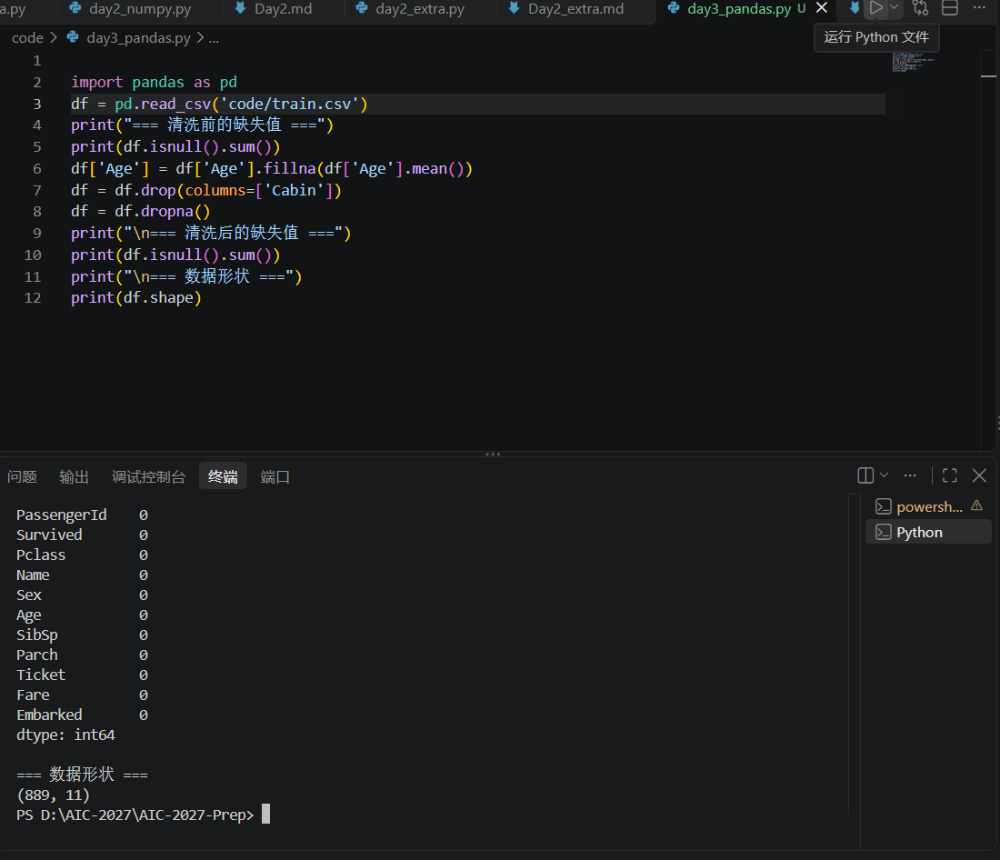
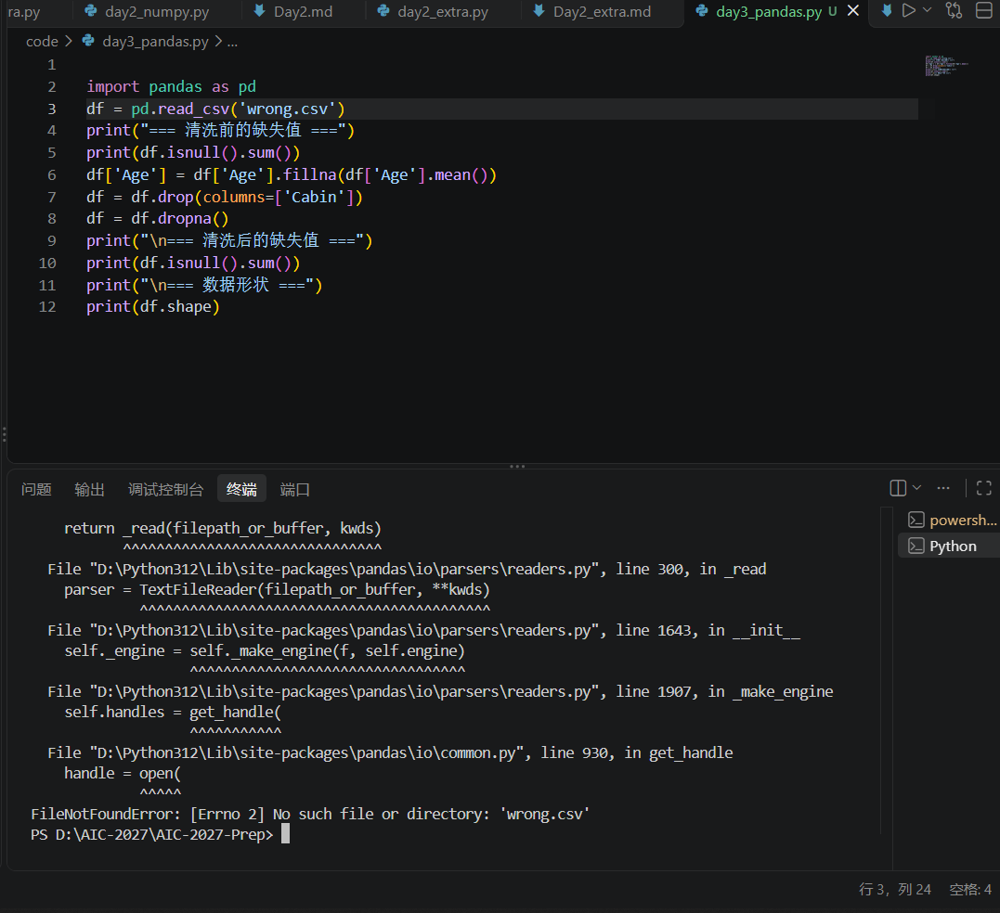

# Day 3 实验日志：Pandas 脏数据清洗实战

## 1. 今日目标
- 掌握 Pandas 读取 CSV 文件、查看缺失值、填充缺失值、删除无用列的方法。
- 完成 Titanic 数据集的清洗，得到可用于后续分析的结构化矩阵。

## 2. 操作过程
- 下载并导入 Titanic 的 `train.csv` 数据集。
- 使用 `isnull().sum()` 统计各列缺失值。
- 使用 `fillna()` 和 `mean()` 将 `Age` 列的缺失值用平均值填充。
- 使用 `drop()` 删除了缺失过多的 `Cabin` 列。
- 使用 `dropna()` 删除了剩余包含缺失值的行。

## 3. 核心结果
- **成功截图**：
- 终端输出显示，清洗后所有列的缺失值均为 0。
- 最终数据形状：`(889, 11)`，即 889 行、11 列，说明数据已被完美清洗。

## 4. 踩坑与失败记录
- **报错现场截图**：
- **报错信息**：`FileNotFoundError: [Errno 2] No such file or directory: 'wrong.csv'`
- **报错原因**：我为了测试排错机制，故意将读取的文件名改成了不存在的 `wrong.csv`。同时，因为我是在项目根目录运行代码，最初写 `'train.csv'` 时，电脑在根目录找不到文件。
- **解决处方**：将读取路径修正为相对于根目录的 `'code/train.csv'`，运行成功。

## 5. 总结与反思
- 数据清洗是 AI 任务中最耗时但也最重要的一步。如果不处理缺失值，后面扔进模型里就会报错或者得出荒谬的结论。Pandas 的函数让清洗变得像操作 Excel 一样直观。