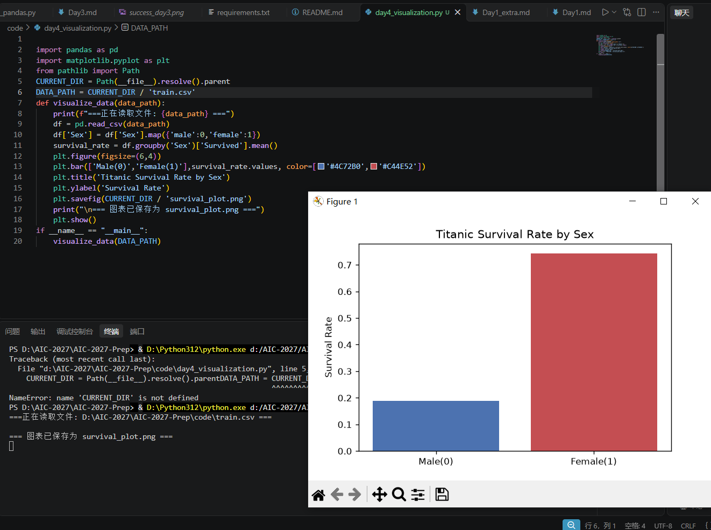
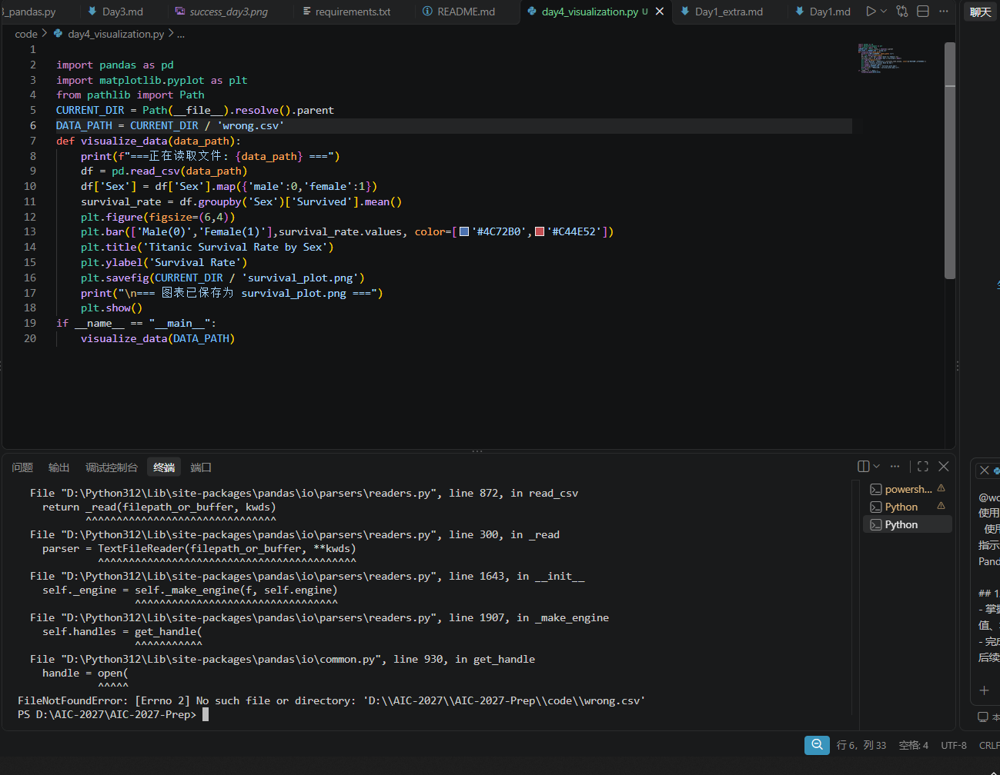

# Day 4 实验日志：特征工程与数据可视化

## 1. 今日目标
- 掌握分类文本特征（性别）向数值特征（0和1）的转换。
- 掌握 Pandas 的 `groupby` 分组统计与 `map` 映射。
- 掌握 Matplotlib 绘制柱状图并保存图片。

## 2. 操作过程
- 编写 `day4_visualization.py`。
- 使用 `Path(__file__)` 自动定位读取 `train.csv`。
- 将 `Sex` 列用 `map` 映射为 0 和 1。
- 计算男女生存率，使用 `plt.bar` 绘制柱状图并保存为 `survival_plot.png`。

## 3. 核心结果
- **成功截图**：
- 终端输出成功生成 `survival_plot.png`。
- 图表直观显示：女性存活率极高，男性存活率极低。

## 4. 踩坑与失败记录
- **报错现场截图**：
- **报错信息 1**：`NameError: name 'CURRENT_DIR' is not defined`
  - **原因**：在敲路径代码时，把两行代码黏在了一行，导致 Python 解析错误。
  - **解决**：在 `parent` 后面加了回车换行，成功运行。
- **报错信息 2**：`FileNotFoundError: [Errno 2] No such file or directory: '.../wrong.csv'`
  - **原因**：故意将文件名改错，测试路径防呆机制。
  - **解决**：将路径改回 `'train.csv'`。