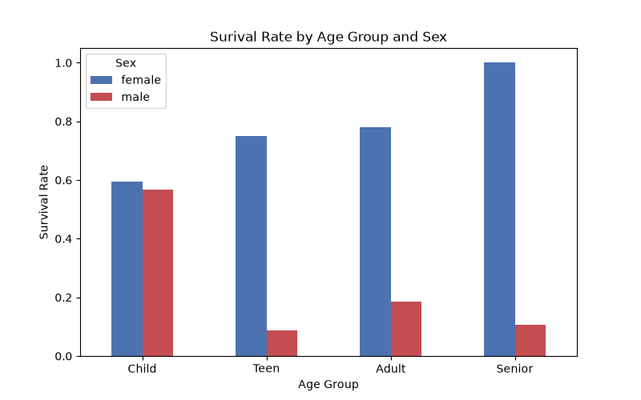
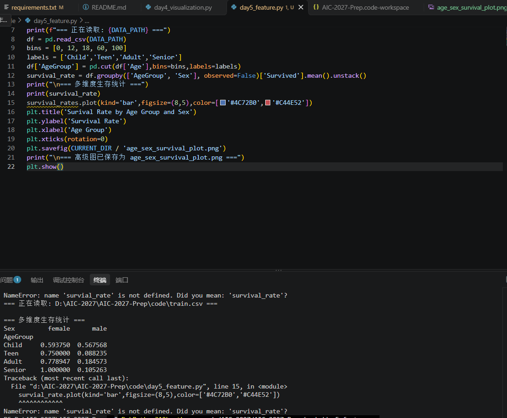
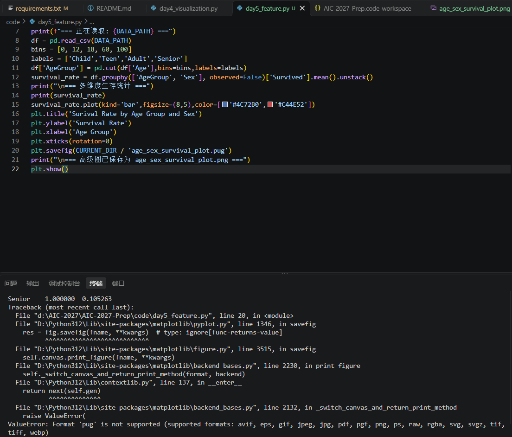

# Day 5 实验日志：进阶特征工程与多维度可视化

## 1. 今日目标
- 掌握 `pd.cut` 对连续数值（年龄）进行分箱离散化的方法。
- 掌握 Pandas 多重条件分组 (`groupby` 两个字段) 及 `unstack()` 转换。
- 掌握 Matplotlib 绘制分组柱状图。

## 2. 操作过程
- 编写 `day5_feature.py`。
- 将年龄分为：Child (0-12), Teen (13-18), Adult (19-60), Senior (60+)。
- 计算不同年龄段和性别的组合存活率。
- 绘制并保存分组柱状图。

## 3. 核心结果
- **成功截图**：
- 终端打印出了多重索引的存活率表格。
- 图表直观显示：无论哪个年龄段，女性的存活率都明显高于男性；且儿童（Child）的存活率极高，老年人（Senior）中女性存活率甚至达到了 100%。

## 4. 踩坑与失败记录
- **报错现场截图 1**：
- **报错信息 1**：`NameError: name 'survival_rates' is not defined`
  - **原因**：在画图时手滑多打了一个 `s`，导致变量名前后不一致。
  - **解决**：将变量名统一改为 `survival_rate`。
  
- **报错现场截图 2**：
- **报错信息 2**：`ValueError: Format 'pug' is not supported`
  - **原因**：保存图片时，把后缀名 `.png` 错打成了 `.pug`。
  - **解决**：将后缀名改回 `.png`，成功保存图表。